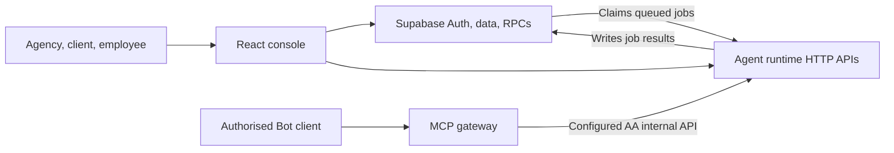

# AA Console

AA Console is Attract Acquisition's browser workspace for agency, client, and employee operations. This repository also contains the Supabase schema history, a separate agent runtime, and a separate MCP gateway for permissioned Bot actions. Each component has its own deployment and credentials.

## How the pieces connect

The console queues background work through Supabase; the runtime claims those jobs under leases and writes results back. Some console features also call authenticated runtime HTTP endpoints directly. The gateway is a separate authorization and approval boundary for Bot requests. See [Repository architecture](docs/repository-architecture.md) for source links and trust boundaries.

## Repository layout

| Path | Purpose |
| --- | --- |
| [`src/`](src/) | React, TypeScript, and Vite frontend; admin, client, and employee routes |
| [`supabase/migrations/`](supabase/migrations/) | Versioned database schema, policies, and RPC changes |
| [`agent-runtime/`](agent-runtime/) | Node worker and HTTP service for agent jobs and AA APIs |
| [`aa-mcp-gateway/`](aa-mcp-gateway/) | Standalone MCP service with Bot permissions, approvals, and audit storage |
| [`.github/workflows/`](.github/workflows/) | CI and browser-app deployment workflows |

The gateway and runtime are separate services. Starting the Vite app does not start either service or apply database migrations.

## Run the browser app locally

Use **Node 22** and npm. You need a Supabase development project with the schema and access policies appropriate to the branch you are testing.

1. Install the frontend dependencies: `npm ci`.
2. Copy `.env.example` to `.env.local` and set `VITE_SUPABASE_URL` and `VITE_SUPABASE_PUBLISHABLE_KEY` for the development project. Set `VITE_AGENT_RUNTIME_URL` only when you intend to test features that call a configured runtime.
3. Start the development server: `npm run dev`.

Only browser-safe values belong in `VITE_*` variables: Vite places them in the browser bundle. Keep service-role keys, model-provider keys, Bot tokens, and reviewer tokens in their respective server environments. See [runtime setup](agent-runtime/README.md), [gateway setup](aa-mcp-gateway/README.md), and [database notes](supabase/README.md) before connecting those components.

## Checks

Run each package's checks from its own directory after `npm ci` there:

| Directory | Commands |
| --- | --- |
| Repository root | `npm run lint` · `npx tsc -b` · `npm test` · `npm run build` |
| `agent-runtime/` | `npm run typecheck` · `npm test` · `npm run build` |
| `aa-mcp-gateway/` | `npm run check` · `npm test` · `npm run build` |

[CI](.github/workflows/ci.yml) runs these checks on pull requests. The runtime test workflow installs FFmpeg so render tests do not silently skip. Tests and builds do not verify a live deployment or a live Supabase migration state.

## Release boundaries

A push to `main` triggers the [GitHub Pages browser deployment](.github/workflows/deploy.yml). The runtime and gateway have separate deployment procedures; a frontend build does not deploy them. Follow [AGENTS.md](AGENTS.md) for the release boundary and consult [SEC_BAR.md](SEC_BAR.md) for its phase-specific gates. Prepare a reviewable PR; production migrations, Railway deployments, and merges require the established Alex/Chief of Staff release path.

For feature and workflow context, start with [the architecture map](docs/repository-architecture.md) and the relevant component README. The root README describes the repository as checked in; it is not a claim that every feature is live in production.
