# Manual-first client journey: M0 source contract

19 November 2026. **Candidate design, not a live acceptance or signed-off release.** This records the current source and the data-preserving change needed by the [manual-first goal](/Users/alex/Desktop/AA-Console-manual-first-build-goal-2026-11-19.md). The signed-in browser host was unavailable during this review; rendered and deployed behavior still needs a separate check. Source branch: `feat/client-delivery-completion`, committed head `5c8b34a` when inspected. Three untracked Archive-return files were present and were left unchanged.

## Current source versus required operator journey

| Step | Current candidate source | Required route and compatibility rule |
|---|---|---|
| Intelligence | Record workspaces retain generated sections and source reviews; campaign input snapshots are separate. | Edit each correctable panel with saved/error state. Preserve a plan's input version when a later model is edited. |
| Opportunity | Market Opportunities has a searchable list, selected Evaluate/Strategize/Activate sections, agent proposal actions and exact AAL2 opportunity approval (`approve_opportunity_v6`). | Reuse its weighted score and evidence ladder. An agent proposal stays inspectable and correctable; only the current human approval makes an opportunity eligible for a targeted offer. Activation is a separate selected state. |
| Offer | `OfferStudioPanel` displays one table, four creation/compile controls, and version detail. `service_offers`, immutable `service_offer_versions` and exact signoffs already exist. Current main offers bind reviewed Offer Strategy; secondary offers bind an approved opportunity. | Replace the four controls with **Offers** and **Build**. Build starts with **Approved opportunity** or **Baseline service**. Both lead to a proposed exact version, then the existing human signoff. Old offer and version IDs stay readable and usable under their existing guards. |
| Campaign | `CampaignExecutionPanel` currently requires an approved opportunity and signed secondary offer to create every new campaign through `create_sourced_campaign_plan_v7`. It stores route as organic, paid or both; route packages and exact package reviews already exist. | Choose type first: standalone paid, standalone organic or opportunity campaign. Type and channels are distinct. Only the opportunity type requires an approved opportunity and its signed offer. Standalone types may bind an approved service offer but do not invent an opportunity link. |
| Campaign detail | Current tabs are Plan/Content/Launch for organic and Plan/Content/Landing Page/Sales Agent/Meta Ads/Launch for paid, regardless of which conversion modules were selected. | Plan and Launch always show. Paid, Organic, Landing Page, Sales Agent and Lead Magnet show only when selected. Each uses the owning module's record and readiness; no duplicate campaign asset. |
| Video | The older generated-video and Motion Design producer paths are present. The code-rendered motion plan is a plan, not an implemented renderer. | Keep historical projects and supplied-footage editing. Introduce branded vector-only IR → deterministic Remotion render → aligned audio → exact review → downloadable MP4 before retiring the generated route. |

## State and field contract

```mermaid
flowchart LR
  I[Reviewed Intelligence] --> O[Opportunity hypothesis]
  O --> E[Agent evaluation and strategy proposal]
  E --> H[Corrected evidence and human AAL2 decision]
  H --> A[Approved and activated opportunity]
  A --> TO[Targeted proposed offer]
  I --> BO[Baseline service proposed offer]
  TO --> S[Exact offer signoff]
  BO --> S
  S --> C[Campaign type and selected channels/modules]
  C --> P[Versioned plan and route packages]
  P --> W[Owning producers and QA]
  W --> R[Exact preparation package review]
  R --> L[Launch checklist and separate external decisions]
```

1. **Opportunity:** keep `market_opportunities`, weighted factors, confidence, evidence/strategy proposals, `opportunity_links`, readiness and current exact approval. A proposal or high score is not approval. An edit that changes the approval fingerprint invalidates new downstream use; old campaign/source snapshots remain historical.
2. **Offer:** keep `service_offers.id`, `kind`, `service_offer_versions.id/version/content_hash`, `service_offer_signoffs`, and the current main/secondary source snapshots. Add Build form fields for dream outcome, likelihood mechanism/proof, delay reduction, effort reduction, risk reversal, up to five bonuses, scarcity, urgency and delivery limits. A baseline offer identifies a client service and reviewed Offer Strategy with no opportunity ID. A targeted offer identifies one currently approved opportunity. The existing exact version signoff is the transition `proposed → approved`; no in-place version edit.
3. **Campaign type:** add an explicit versioned type with values `standalone_paid`, `standalone_organic`, `opportunity_campaign`. Existing `acquisition_mode` and `runs_paid/runs_organic` remain the channel authority for old readers, with a consistency guard: paid only, organic only, or both. For legacy records, infer a display label from existing links and route but retain an explicit `legacy/unknown` state when inference is not reliable; do not backfill an invented approved opportunity.
4. **Selected modules:** freeze `landing_page`, `sales_agent` and `lead_magnet` selections in the plan/version fingerprint alongside channels, selected offer version, content requirements and operator direction. Required work items and tabs derive only from selected modules. Changing a selection creates a plan revision and invalidates dependent package approval; it does not rewrite the already approved package.
5. **Lineage:** opportunity campaign → current `opportunity_links` role `campaign` → signed secondary offer version → separate organic/paid route packages. Standalone campaign → optional signed service offer version and **no** opportunity link. Keep existing `campaign_manifest_offers` and package IDs. A paid pack export carries exact approved bytes, copy, placement, offer, destination and tracking instructions; export is a handoff, not activation.

## Migration and API compatibility plan

- Add a guarded campaign-type field and versioned module selections with a migration after the reviewed candidate head. Backfill only unambiguous old rows; show ambiguous ones as legacy/unknown. Do not rewrite `acquisition_mode`, route package IDs, opportunity links, offer versions, signoffs or historical manifests.
- Create a standalone campaign writer with the same signed-in client scope and atomic planner queue behavior as `create_sourced_campaign_plan_v7`; require name, purpose, idea choice and the relevant channel. An optional offer must be an exact current signed version for the same client. It writes no opportunity link. Keep `create_sourced_campaign_plan_v7` available for old clients and the opportunity path until the new unified writer is tested.
- Extend the opportunity writer to persist type and selected modules atomically with its source and plan inputs. Its current exact opportunity and secondary-offer checks remain mandatory. Use the existing plan revision and package invalidation rules for edits.
- Build UI reads both new and old records. The old Offer Studio `?tab=versions&offer=` deep link should lead to Build with that offer selected; the old creation controls have a replacement in Build. Existing approved offers remain selectable by standalone campaigns subject to their current source/claim guards.
- Test the three types, paid+organic opportunity route separation, an unselected module producing no work/blocker, stale opportunity/offer, wrong client, legacy deep links, exact AAL2 review, and retry without duplicate campaign or asset rows. Do not call a source test a provider receipt.

## Verification still required

- Signed-in current pages and deployed component identities; the browser access host was unavailable during this M0 source review.
- A reviewed field-level design of the new Offer Build and Campaign New/Detail screens, then source implementation and local migration/fixture coverage.
- Alex's product signoff on this contract, including treatment of ambiguous legacy campaign types. This document does not authorize migration or deployment.
- Remotion licence and rendering/audio account choices before production video rendering. The first milestone excludes YouTube publishing and supplied-footage replacement.
