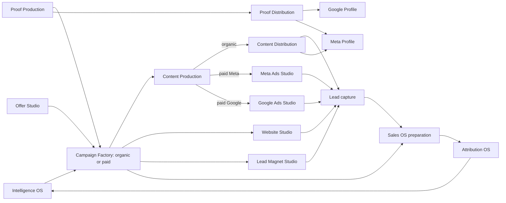

# AA Console v6: completion baseline and page-by-page plan

**Baseline date:** 16 October 2026. **Purpose:** freeze what the repository currently does and the intended completion path before Alex gives page-level design and workflow instructions. This is a working baseline, not a claim that v6 is finished. Alex's subsequent granular instructions are the controlling product specification; record each difference here, implement it, then compare the resulting system with both those instructions and the remaining v6 acceptance gates.

The approved architecture and decisions are in [the v6 system map](v6-service-business-acquisition-system.md). The older production workflow and unresolved video quality evidence are in [the v5 backend map](v5-backend-capability-map.md) and [video workflow plan](video-content-workflows-plan-2026-10-10.md). Those documents contain historical checkpoints; current code and observed runtime evidence take precedence over an old status sentence.

## 1. Product contract and present state

AA Console is a **per-client Service Business Acquisition System** for any service business. The campaign is the coordinating object. It draws from intelligence, offer and genuine proof; specifies conversion assets and a single acquisition route; shapes content; prepares distribution; sends prospects into sales; and receives measured commercial outcomes. A campaign is **organic or paid**, never both. Reusing a successful campaign on the other route creates a new campaign with lineage, its own assets, approvals, activation and results. Paid campaign platform is a separate selection.

Internal research, ideation, production, revisions, QA and package assembly may be automated. Every external effect requires human approval of the **exact artifact version, destination, action and scope** before an idempotent executor performs it. This includes publishing a post or proof, deploying a page or agent, sending lead communication, creating or activating ads, and changing spend. The active assigned SMM/manager and one configurable owner account are the review principals; client review can be added at its appropriate gate. An AI QA verdict is never a human approval. Missing credentials, consent, rights, account linkage or approval block the relevant external action without blocking unrelated internal preparation.

### Release and evidence level

The last recorded v6 rollup is merged to `main` at `65278b1576563acce5c815de1902069c84bdf387` via [PR #209](https://github.com/AttractAcq/AA-Console/pull/209). The recorded release applied v6 migrations 203–213, published the frontend, and deployed runtime and gateway at that commit; frontend, runtime health and gateway health returned HTTP 200. This is **release and process-health evidence**, not an end-to-end acceptance test for any v6 module. Reconfirm deployed SHA, migration state and behavior before marking a future slice complete.

The Delivery sidebar and routes are implemented for **15 modules plus four utilities**. Eleven module pages reuse working v5 features or contain a v6 foundation; four explicitly show Planned. No module has yet passed its entire v6 end-to-end gate. In particular, campaign `live` is not proof of live ads, a published page, a functioning form or acquired revenue. Do not convert a UI badge, model response or database row into a stronger claim than its evidence supports.

| Evidence label | Meaning for this plan |
|---|---|
| Visible | Route, tab or panel renders and remains reachable. |
| Internal | Data is saved or an agent job runs inside AA Console. |
| Prepared | Immutable version, review package or approval request exists. |
| External | An approved executor changed the named external destination and stored its result. |
| Outcome | A real submission, lead, booking, sale or cash event is linked to the campaign with uncertainty stated. |

### Existing architecture and normal user journey

The React Delivery page shell and tab-to-panel map live in `src/config/navigation.ts` and `src/pages/Page.tsx`; React modules call Supabase RPCs and the runtime API. Supabase holds client records, jobs, versions, approvals and operational state. `agent-runtime` runs model and media jobs, publishes through supported connectors and serves controlled build endpoints. The MCP gateway exposes selected operations to Chief of Staff and other authorized callers. The older `campaigns` table is a spend/reporting identity; `client_campaigns` is the operational acquisition plan. These must be bridged explicitly rather than conflated.

The arrows are the **target dependency and evidence flow**, not an assertion that each connector already works. A typical operator opens a client, confirms intelligence and offer, creates a route-bound campaign, requests a campaign plan, reviews the manifest, creates proof/content/page/magnet/agent assets, resolves blockers, sends exact versions to the Approval Inbox, activates supported destinations after approval, then observes leads and outcomes. Chief of Staff must be able to request internal preparation through MCP up to the human gates and receive durable status rather than a narrative assertion.

## 2. The 15 Delivery pages

The sidebar order below is intentional and must remain first-class. Each subsection records the **current visible UI**, **current function/automation**, **target flow**, and **acceptance gate**. `Planned` means the page intentionally says so; it is not a broken hidden feature. Existing v5 panels may appear in more than one v6 context while links migrate.

### 1. Intelligence OS — `/delivery/intelligence-os`

- **Current UI:** Business Context, Market, ICP, Competitors, Branding & Associations, Campaign Intelligence, Campaign Inputs, Proof Intelligence, Branding Strategy, Content Pillars and Money Model Strategy tabs. The inherited research and strategy editing surfaces remain accessible; PDF and ZIP export still distinguish intelligence from strategy.
- **Current function/automation:** The campaign planner freezes a versioned input snapshot containing available client research, source IDs, update dates, selected pillars, brief and route. The Campaign Inputs tab exposes it for audit. Planner retries reuse the frozen input; a new job can use newer research. Missing intelligence is recorded rather than fabricated.
- **Target flow:** Give each campaign an explicit, inspectable opportunity hypothesis with source freshness, competitor/market context, strengths, unknowns and provenance. Allow a manager to refresh inputs and deliberately replan a new package version. Feed observed commercial outcomes back into opportunity assessment without rewriting past snapshots.
- **Completion gate:** A campaign shows exactly which research version informed its plan; stale or absent research is visible; the resulting hypothesis can be traced to evidence and measured outcomes. Preserve all eleven tabs and both exports.

### 2. Campaign Factory — `/delivery/campaign-factory` and detail `/:campaignId`

- **Current UI:** Campaign list, detail, brief/objective/offer/budget/dates, route label, source-campaign link, planner action, content links, readiness list, page/agent build actions, Meta Build section where applicable, clone and archive. New-campaign form can bind a human-approved service-offer version. Legacy campaigns say Legacy route and can be cloned. New v6 launch UI explains that activation awaits a version-bound approval executor.
- **Current function/automation:** New `client_campaigns` rows choose immutable organic or paid mode and a paid platform. Clone carries only the brief and approved offer selection, not assets, approvals or results. Campaign planner creates an immutable route-bound manifest with dependency items; an intelligence snapshot and exact offer version can attach. Planner recovery finalizes these after a crash without another model call. The MCP v6 create route is idempotent. A database guard blocks v6 transition to `live`. The legacy readiness RPC and manual page/agent provision still exist, but do not prove a v6 launch.
- **Target flow:** Campaign detail becomes the operational acquisition package: objective, audience, intelligence snapshot, signed offer, proof, creative, site page, optional magnet, sales path, route-specific activation, required/optional status, QA, exact approval and observed result. One orchestrator advances each validated dependency and exposes blockers, retry, cost and evidence. A clone starts a new route-specific lifecycle. Link operational campaign identity to ad spend records and external IDs.
- **Completion gate:** From one command, a new paid or organic campaign prepares all scoped internal artifacts; the manifest is truthful and versioned; no external write occurs before exact approval; approved execution records destination IDs and failures; old and legacy campaigns remain readable. A `live` state requires observed external activation, not only internal readiness.

### 3. Proof Production Factory — `/delivery/proof-production-factory`

- **Current UI:** Proof Bank and Proof Artifacts tabs. Proof Bank retains evidence and rights workflows. Artifacts lets a user choose source proof, manually draft/revise a GEO answer, SEO case study or local snippet, request an AI draft and approve a version. Version and source appear in the list.
- **Current function/automation:** Source proof defaults to uncleared; rights basis, expiry and rights-change events are recorded. Immutable derivative versions include source snapshot and supported excerpt. Agent drafting is queued. Database checks enforce same-client source and verbatim excerpt; human artifact sign-off rechecks current rights, basis, expiry and source integrity. Automatic checks do not establish semantic truth by themselves.
- **Target flow:** Capture/import genuine Google reviews and business evidence with author, URL, date, location/service, consent/permission, expiry and removal history. Make proof searchable and reusable, generate reviewable GEO/SEO derivatives and campaign creative claims, attach them to campaigns, and clear each intended channel separately. Revocation must invalidate pending uses and alert live destinations for correction.
- **Completion gate:** A proof artifact can be traced back to a genuine, currently usable source and its supported claims; channel clearance is explicit; a rights change blocks new use and creates a remediation trail. No synthetic testimonial can be treated as proof.

### 4. Content Production Factory — `/delivery/content-production-factory`

- **Current UI:** Ideation, Briefs, Create, Edit / Repurpose, Images, Videos, Reel Shots, Copy, Stories and Carousels tabs. Create reuses the briefs view with create-stage actions. Media libraries and candidate reviews remain visible. Ideation supports destination, media type, format, campaign association and idea quantity; brief approval queues the brief builder. Create offers AI or human assignment. Edit / Repurpose accepts uploaded/returned video and offers AI edit, human edit or approval. Motion Design stays on its separate utility page.
- **Current function/automation:** V5 agent jobs produce copy, images and carousel/story assets; reel briefs drive image stills to Higgsfield image-to-video clips and an FFmpeg/Claude edit. The current reel path has candidate history, technical media probes and sampled full-cut creative review; rejected source sets can be rebuilt in bounded fashion. Source-video editing takes instructions such as pause removal, captions, aspect, title, brand treatment and feel, then generates an edit plan and render. Video repurposing extracts clips and related ideas. Human assignments connect to role dashboards; email depends on Resend configuration. Reviewable assets go to owner/SMM approval. These are real internal capabilities, but live premium creative consistency and every human return path are not yet proven.
- **Target flow:** The campaign manifest chooses formats, platform, intended distribution and approved offer/proof. The intuitive stage spine remains **Ideation → Brief → Create (AI or human) → Edit / Repurpose (AI or human) → Approval → Distribution → Track/Analyze/Learn**. Repurpose creates a new child content branch routed back to ideation, brief or create, with source and permission lineage. All AI and human paths converge on the same versioned asset, QA and approval model. Video direction includes multiple shot candidates, continuity checks, sound/narration policy, brand treatment, clear full-cut creative criteria and human acceptance. Do not expand expensive video providers merely because a model is newer; benchmark same brief, source frame, quality, latency and actual cost. Preserve the working image paths.
- **Completion gate:** A campaign-linked reel passes real generation, edit, timed technical and creative review, owner/manager approval and a verified destination handoff. A human-shot source can enter the same edit/approval flow; repurposed branches preserve lineage; every existing content format and media library works. A representative blind human review judges the output good enough for a premium service business, not merely playable.

### 5. Proof Distribution — `/delivery/proof-distribution`

- **Current UI/function:** Explicit Planned page; no dedicated proof publisher or destination evidence yet. Existing general publisher primitives do not establish Google Business Profile publication.
- **Target flow:** Package a cleared proof derivative for a specific destination (for example Google or Meta profile), show exact copy/media/claims/source/rights, request version-bound approval, publish through that destination's supported adapter and store external ID, timestamp, URL, retries and removals. Handle proof used in organic/paid creative through those studios while retaining source lineage.
- **Completion gate:** An approved proof item appears on a real supported account, its external record is verifiable, and revocation/expiry blocks later posting and opens remediation for previously published proof.

### 6. Content Distribution — `/delivery/content-distribution`

- **Current UI:** Assets, Organic and Engine tabs. Assets prepares/schedules approved items. Organic lists organic posts; Engine exposes due work, blockers, account cadence, posting windows and publishing controls. The old Paid board is accessible in Meta Ads Studio and the legacy route.
- **Current function/automation:** Existing Instagram/Facebook publication and schedule infrastructure can send human-approved posts when platform/client switches, credentials and due-time checks allow it. `publish_due` surfaces blocker reasons and attempt counts. Ideation policy approval is distinct from final human publication approval.
- **Target flow:** Only organic-mode campaign content enters the organic queue. A distribution package names exact content version, destination account, copy/crop, time window, approval and idempotency key. Worker writes real external IDs and distinguishes queued, attempted, delivered, failed and removed. Campaign detail and Attribution OS receive observed results.
- **Completion gate:** A campaign-linked, human-approved asset reaches a real supported account once; edited versions require new approval; failures/retries and platform links are visible. Paid items never enter the organic publisher by inference from format.

### 7. Google Ads Studio — `/delivery/google-ads-studio`

- **Current UI/function:** Explicit Planned page. A Google provider selection elsewhere is not a production Google Ads builder or deployer.
- **Target flow:** Connect the client's Google Ads account; derive search intent, keyword groups, negatives, geography, ads, assets, budget, conversion targets and landing page from a paid-Google campaign package. Preview exact external objects and spend scope; human approval precedes even paused object creation. Activate and optimize only within approved bounds; ingest spend, clicks, leads and conversion IDs.
- **Completion gate:** A real-account test proves draft/build, exact approval, object creation, activation, change control and measured outcomes with reliable external IDs and spend limits. Unsupported account states fail closed.

### 8. Meta Ads Studio — `/delivery/meta-ads-studio`

- **Current UI:** Campaign Builds, Paid Distribution and Paid Reporting tabs. Campaign detail can show Meta Build; a new v6 paid-Meta campaign can plan internally, but external Meta actions are held. Legacy paid controls remain accessible.
- **Current function/automation:** Existing Meta build jobs, copy and creative planning, paid board and reporting exist; older flow can create paused ad objects. A paused object is still an external write. The v6 route deliberately disables external build until exact-version approval and execution are connected.
- **Target flow:** Build campaign/ad set/ad package from the approved offer, audience, creative, proof rights, campaign page and spend plan. Show exact payload, account, audience, budget and destination for approval; idempotently create paused objects, separately approve activation and budget changes, then monitor and optimize within scope. Reconcile Meta IDs and spend with operational campaign identity.
- **Completion gate:** A paid-Meta v6 campaign goes from internal plan through signed build and activation to live measured performance on a real account, with no external write on a stale approval or legacy bypass.

### 9. Google Profile — `/delivery/google-profile`

- **Current UI/function:** Explicit Planned page. No verified Google Business Profile management adapter in the current repo.
- **Target flow:** Connect/verify location(s), inspect profile completeness, hours/services/photos, ingest authentic reviews, propose responses and proof posts, and require exact approval before changes or replies. Display observed profile state and metrics; route cleared proof through Proof Distribution.
- **Completion gate:** A real profile can be read and an approved change/reply/post can be observed by external ID; invalid location access or revoked permission blocks writes.

### 10. Meta Profile — `/delivery/meta-profile`

- **Current UI:** Posts and Profile Metrics tabs reuse organic distribution and Instagram organic reporting. Existing Meta account context is available elsewhere.
- **Current function/automation:** Instagram/Facebook post publishing and organic metrics paths exist. This is a profile presence surface, not a complete campaign or profile management studio.
- **Target flow:** Show connected Instagram/Facebook identities, permission and health state, profile details, approved changes, reviews/messages where supported, content presence and profile outcome metrics. Link posts to campaign/proof records without duplicating Content Distribution ownership.
- **Completion gate:** Real account state and approved profile operations are observable; a disconnected account or unsupported operation is stated explicitly.

### 11. Offer Studio — `/delivery/offer-studio`

- **Current UI:** Service Offers and Offer Strategy tabs. Draft a service-specific offer with audience, promise, inclusions, limits, price/cost and claims; see immutable version history, approve a version and attach it to a campaign package. Campaign creation can select an approved version.
- **Current function/automation:** Offer sign-off checks quantified claims against same-client cleared, unexpired proof. Campaign planner, campaign-linked page builder and sales-agent builder freeze the selected/attached offer version in their job inputs. Retries check for changed package/rights and fail closed. Legacy or standalone work still uses client-wide Offer Strategy.
- **Target flow:** One canonical offer record per service/segment with structured economics, eligibility, constraints, evidence, approval, active dates and performance. The same signed offer version reaches campaign, ads, page, magnet and sales instructions. Add deterministic claim review of generated copy, explicit supersession and outcome feedback.
- **Completion gate:** Every produced acquisition asset exposes its offer-version ID and claim evidence; changing the offer creates a new version and approval path; no contradictory live copy is silently inherited.

### 12. Website Studio — `/delivery/website-studio`

- **Current UI:** Landing Pages, Offer Pages, Sites, Landing Results and Offer Results. Page Builder creates/edits pages, AI build/revision and preview; Sites shows client site repository and pages. A built v6 campaign page can request review from Website Studio. Approval Inbox shows a frozen script/form-disabled page preview.
- **Current function/automation:** Existing site/page build, audit, revision and legacy publishing infrastructure exists. A v6 request freezes current saved revision, HTML SHA-256, safe path, intended URL and site, tied to latest campaign package. Changed page or destination invalidates decision. Database/runtime guards currently **block v6 campaign page publication**, including legacy publisher and the reverse path of attaching a live page to a v6 campaign. Pages with sales-agent widgets wait for a separate exact-render approval path. Approved request alone does not deploy.
- **Target flow:** Campaign package defines one or more page roles and conversion path. Validate copy/offer/proof claims, accessibility/performance basics, forms, consent, source propagation and destination. Human approves exact rendered bytes and URL. A version-checking idempotent executor publishes; post-publish probe submits a test form and verifies a correctly sourced lead and event. Revisions or agent-widget changes require fresh approval.
- **Completion gate:** An approved campaign page is live at its intended URL with recorded revision and external commit; a real test submission reaches Sales OS with campaign/source/consent; stale approval or broken form prevents a false live state. Retain standalone/legacy page behavior.

### 13. Lead Magnet Studio — `/delivery/lead-magnet-studio`

- **Current UI/function:** Explicit Planned page; no dedicated magnet entity or fulfilment flow. The campaign manifest has an optional magnet dependency by default, not a generated working magnet.
- **Target flow:** Define magnet objective, audience, approved offer and campaign, content/version, delivery method, consent and page placement. AI can internally draft it and QA it; human approves the exact external download/send path. Fulfilment stores delivery evidence and a lead/campaign/source link. Campaigns without magnets explicitly mark the component out of scope.
- **Completion gate:** A real user can submit an opt-in, receive the exact promised magnet once, and be recorded as a consented, attributed lead; failures and withdrawals are visible.

### 14. Sales OS — `/delivery/sales-os`

- **Current UI:** Prospects & Leads pipeline and Sales Agents tabs. Leads can be created, opened, assigned, dragged through stages and archived; stall warnings, opportunities, appointments, sale/cash fields and event history are present. Agents have role-specific instructions, qualification, objection, booking and handoff views; build and public-use controls exist.
- **Current function/automation:** `client_leads` and lead events are primary records. Agent builder reads ICP, strategy, brand and cleared proof and, when campaign-linked, freezes the approved offer version. Public-agent approval and site placement controls exist, but are not yet the universal v6 exact-render external-action gate. Lead nurture and external sends are not proven as one automated, governed journey.
- **Target flow:** Normalize capture from pages, magnets, ads, calls, profile/referral and manual entry with campaign/source IDs and consent. Deduplicate, score/qualify, assign an owner, schedule next actions, send bounded approved nurture, book, hand over, record sale/cash and preserve every event. Campaign-linked agent configuration must have exact-version deploy approval and revocation.
- **Completion gate:** A real sourced test lead moves capture → qualification → nurture/handoff → booking → sold/cash with event provenance and correct attribution; no unapproved external message or agent deployment occurs.

### 15. Attribution OS — `/delivery/attribution-os`

- **Current UI:** Attribution, Organic, Paid, Landing Pages, Offer Pages, Commentary and Economics tabs; inherited reporting and financial views remain usable.
- **Current function/automation:** Existing metrics ingestion and reporting offer observed/estimated/unknown notions, paid and organic metrics, page results, commentary and economics. A complete operational-campaign-to-legacy-spend bridge and lead-to-cash path across all new studios has not been validated.
- **Target flow:** Join `client_campaigns` plan, package and activation versions to legacy `campaigns` spend rows, platform campaign/ad/post/page IDs, UTM/click IDs, lead/source/consent events, appointments, closed sale and cash. Report coverage, confidence and missing links. Feed evidence, not model stories, back into Intelligence OS and campaign decisions.
- **Completion gate:** For at least one campaign per supported route, a user can follow actual cost/creative/destination → lead → booked outcome → sale/cash where present. Missing joins remain Unknown; observed and estimated values are never merged without labels.

## 3. Four visible utilities and retained client surfaces

| Utility | Current UI and function | Required v6 destination |
|---|---|---|
| Dashboard | Existing client overview is first in Delivery. | A truthful acquisition overview: campaign stage and blockers, approvals, channel/account health, leads, revenue and attribution coverage. Keep drill-down to the fifteen owners of work. |
| Approval Inbox | Engine, Assets and Campaign actions tabs. Engine slot and asset queues support their established review paths; campaign-action request records bind manifest/action/destination/version/scope. Page deployment requests show frozen HTML preview. Admin or active assigned SMM can decide the supported campaign request. | One cross-module human queue for all external actions; each card shows exact artifact, destination, scope, cost/budget, rights and consequence. Decisions are immutable/stale-safe; approved executors report external IDs and outcomes. Owner/client routing is explicit. |
| Motion Design | Its own page with prompt, explainer/tutorial/hero preset, aspect, duration, colours, project history, revision, preview, MP4 export and attach-to-content. Current worker asks Claude for a constrained scene plan and renders owned SVG frames/FFmpeg. | A separate agent-like studio with creative brief, brand assets, timeline, scene/code or render iteration, audio where requested, template/brand QA, version history and delivery into Content Production or Website Studio. Compare its output against direct Claude motion-design examples with the same brief; do not assume model name alone yields quality. External publication still goes through the receiving module's approval gate. |
| Archive | Content, pages, campaigns and sales agents retained. | Historical versions and campaign lineage stay searchable, with no archived item silently disappearing from attribution or proof/audit trails. |

Account retains Onboarding, Sites/hosting configuration, Contact/Identity, Brand/Design, Integrations/Credentials, Contracts, Billing and Audit Log. Agency Operations, Team, Admin, employee dashboards and client-facing views remain accessible. V6 compresses the Delivery **navigation**, not the underlying functions or role-specific surfaces. Legacy Delivery URLs continue to resolve during migration; `src/pages/Page.tsx` still maps them, and campaign detail preserves its ID.

## 4. Cross-module work still required

1. **Durable campaign orchestration.** Upgrade the versioned manifest from a dependency checklist to evidence-backed work items. Every item needs owner module, required/optional state, input/output IDs and hashes, job/run ID, QA, retry policy, blocker, approval, activation and observed outcome. One module advances only its own work. The MCP request should start internal work, return durable progress and stop at human gates.
2. **Universal exact-version external execution.** Reuse the current campaign-action request foundation, then add per-destination adapters that lock and revalidate current manifest, artifact bytes, identity, permissions, budget and human decision immediately before write. Record idempotency key, external ID, response, retries and rollback/remediation. Page publishing and v6 Meta build are deliberately blocked until their executors exist. Apply the same boundary to organic/proof publishing, Google/Meta profile, Google Ads, magnet delivery and sales outreach.
3. **Version and lineage graph.** Carry client ID, operational campaign ID, route, manifest version, intelligence/offer/proof versions, source media, derivative assets, destination and external IDs into each job and artifact. Never let a prompt-only reference substitute for a relational binding. Clone and repurpose create new branches while preserving origin. Rights revocation and new versions invalidate dependent pending approvals.
4. **Conversion and attribution proof.** Persist source/consent through page and magnet forms into `client_leads`; bridge operational campaign to spend identity and platform IDs; establish real test submissions and server-observed events. Mark unknown when data cannot be joined. Feedback to intelligence and campaign planning should include dates and sample size.
5. **Creative quality and economics.** Preserve working image generation. Improve reels and motion design with benchmarked models, multi-candidate selection, full-cut temporal inspection, continuity, audio, brand/claim QA and human blind acceptance. Record actual provider usage/cost per job without silently relaxing approval or quality thresholds.
6. **Permissions and operations.** Each client remains isolated. Manager/owner decisions, RLS, service-role-only jobs, credential scopes, kill switches, retries, dead-letter/error visibility and audit logs are release gates. Review and revocation paths matter as much as initial approval.

## 5. Build sequence and acceptance evidence

Alex will give granular instructions for pages and UI before implementation. Apply those changes one page/module at a time, while keeping this inventory as the non-loss checklist. Existing `docs/v6-service-business-acquisition-system.md` specifies the original slice order; the sequence below is the practical dependency path after the current released foundations. Parallel work is safe only when it shares a versioned contract and does not hide an external gate.

| Order | Focus | Deliverable/evidence to close |
|---|---|---|
| 0 | Alex's page instructions and preservation | Record exact requested UI and behavior per page; implement navigation/page changes; route, role and deep-link regression checks show every v5 surface remains reachable. |
| 1 | Campaign core + action executor | Manifest item evidence/state, bound assets, MCP orchestration and first exact-version executor. Prove stale approvals and duplicate requests fail closed. |
| 2 | Intelligence, Offer and Proof inputs | Versioned campaign research/offer/proof association; claims/rights and freshness checks reach all downstream generators. |
| 3 | Content Production and Motion Design quality | Real campaign-linked AI and human video paths plus repurpose; premium blind review, candidate/QA history, unchanged image behavior. |
| 4 | Website, Lead Magnet and Sales conversion | Approved page/agent/magnet deploy or delivery; live form test creates sourced consented lead; complete lead journey and handoff. |
| 5 | Organic and profile distribution | Approved content/proof to supported Meta/Google destinations; external IDs, results and revocation behavior. |
| 6 | Paid studios | Meta and Google account-specific approved build, activation, spend controls and measurement; one real test each when accounts are available. |
| 7 | Attribution and learning | Reconciled campaign → channel → destination → lead → revenue lineage; observed/estimated/unknown reporting and feedback into intelligence. |
| 8 | End-to-end acceptance | Test a complete organic and paid acquisition campaign, including failure/retry and human gates. Confirm all 15 pages + four utilities, role views, legacy links, migrations, deployment SHA and real external evidence. |

Each focused change should include: source inventory; data/API contract; UX state and accessibility; permissions/approval boundary; tests for the meaningful failure and success paths; migration compatibility; operator-visible status; and recorded real-account proof when claiming external completion. Avoid writing tests that merely repeat component implementation. No page is complete because its route exists, its model wrote a plausible answer, its job is queued, or a health endpoint is green.

## 6. How to incorporate Alex's upcoming page instructions

Maintain one row per instruction in the table below before coding. This preserves intent, prevents UI changes from erasing capability, and separates a superseded plan idea from a still-required system gate.

| Page/module | Alex's exact change | Existing feature to preserve | Contract/data/API effect | Implemented evidence | Remaining gap |
|---|---|---|---|---|---|
| To fill from next instruction | — | — | — | — | — |

After each batch: (1) compare the delivered UI and behavior against Alex's instruction; (2) walk the relevant current-state subsection above and test that none of its working functions became hidden or unusable; (3) compare the result against its target and acceptance gate; (4) mark each remaining gap as planned, blocked by a named dependency, or evidenced complete; (5) update the implementation record and links. A later instruction may change layout or ordering and should replace that detail here, while unchanged quality, data lineage and approval obligations persist. Do not call v6 complete until the real end-to-end evidence in section 5 is collected.

**Release boundary:** For subsequent implementation, use a reviewable branch/PR and follow the repository's `AGENTS.md`. That file currently requires Alex via Chief of Staff for merge, production migrations and Railway deployment. Earlier approval covered the recorded release; a new release still follows the current boundary unless Alex directly authorizes it.

## 7. Page restructuring requested 16 October 2026

Alex requested the following UI-only restructuring as the first granular v6 change. V1 continues to use the existing handlers and records. V2 is an explicit workspace for subsequent page-by-page design, with Content Production v2 already reusing the existing production panels. No new v6 external capability is implied by this navigation change.

| Surface | Delivered shape | Preserved path or function |
|---|---|---|
| Sidebar | Minimize/expand control. Intelligence OS expands to Intelligence and Strategy; Campaign, Proof Production, Content Production, Organic Content Distribution, Meta Ads, Meta Profile, Offer, Website, Sales and Motion Design expand to v1/v2. | Existing module URLs open v1, legacy URLs remain routable, version selection is in `?view=`. |
| Client dashboard | Master AI opens from a dashboard button; agent spend, Run Agent, Run All Agents and unresolved failures remain. Recent runs, pipeline cards and five top counters are removed. The agency dashboard's Master AI also opens from a button. | Job-history spend and run actions use their original data and RPCs. |
| Intelligence OS | Intelligence view has its research tabs and intelligence download. Strategy view has Branding Strategy, Content Pillars and Money Model Strategy with only strategy download. | Offer Strategy remains in Offer Studio; legacy strategy URL remains routable. |
| Content Production v2 | Ideation, Briefs, Create, Edit / Repurpose, Assets. Assets nests Images, Videos, Reel Shots, Copy, Stories and Carousels. Stage journey bar is absent from the first four v2 tabs. | V1 keeps all original tabs and stage bar; v2 reuses the same production panels and underlying workflows. |
| Other versioned v2 pages | Heading only, ready for Alex's later specifications. | V1 retains the full current page. Proof Distribution, Google Ads, Google Profile, Lead Magnet, Attribution OS, Archive and other unchanged pages retain their present state. |

The generic sentence about tools being available and capabilities being built was removed from the shared page shell. Planned-module dependency notices remain because they describe actual unsupported operations. Before closing this change, check all version links, tab/export scoping, production build, and the v1 preservation tests. Future instructions should be entered into the comparison table in section 6 and applied to v2 without silently deleting v1 workflows.

## Proof Production Factory v2 — approved specification and first build (18 October 2026)

### Product contract

V2 is a proof production workspace with **Capture → Produce → Repurpose → Assets**. V1 Proof Bank and Proof Artifacts remain available with their existing routes and controls. Capture method, source category/type, media/format and intended destination are separate concepts. Raw evidence is preserved; finished derivatives retain a source reference and repurposed assets retain their parent.

**Capture methods:** Automated Requests; Field Capture Portal; Guided Interview Capture; Integration Capture; Manual Upload & Import; Outcome Follow-up Engine. Each has its own navigable capture view. Integration and Outcome Follow-up are heading-only placeholders by explicit request.

**Source categories and types:**

- Customers: Video Testimonials; Online Reviews; Customer Feedback Forms; Customer-Submitted Photos & Videos; Referral & Recommendation Capture; Customer Interviews.
- Business Operations: Before-and-after Documentation; Proof of Work Capture; Employee Voice Notes / Field Reports; Job Completion Forms; Measured Result Capture; Historical Project Import.
- Independent Sources: Certification & Accreditations; Independent Inspection & Verification; Media Mentions & External Recognition; Organic Mentions and Social Listening; Partners and Supplier Endorsements; Customer Outcome Follow-ups.

These are classifications, not a requirement for eighteen sidebar pages. Existing v1 `proof_type` remains intact. New `source_category`, `source_kind`, `capture_method` and `source_format` store the v2 classification; historical sources remain unclassified rather than guessed.

**Destinations:** Main Website; SEO / GEO Content; Google Business Profile; Organic Social Media; Paid Advertising; Campaign Landing Pages; Sales Conversations; Email / SMS Nurturing; Third Party Directories; Proposals & Quotations. Selecting a destination records production intent and does not publish or send anything.

### Implemented in this first build (requires migration 215 and coordinated release)

- Four v2 tabs; six capture entry points. Configurations are stored per client, editable, and isolated with database policies. Configurations cannot link another client's page.
- Automated Requests saves trigger descriptions, message templates and instructions **as drafts**. Guided Interview saves editable questions/process scripts. Field Capture and Manual Import save capture setup instructions and link existing client pages; Website Studio remains available for page building and publishing.
- Internal manual proof upload retains the existing private proof bucket and adds category/type/method/format inputs. Existing raw sources can still be previewed, structured and cleared through Proof Detail.
- Produce selects a cleared raw source, media, format, destination and direction, with additional video/frame instructions. A transaction creates an idea, a queued brief job and an immutable source-linked request record. Retries of the same request do not duplicate work; changed payloads require a new request ID.
- The brief worker uses the exact selected source rather than choosing a different proof record from the library. It rechecks clearance and rejects model output that fails to cite the selected source. A database trigger enforces source binding on the resulting brief.
- A request row shows brief-job status/failure, Brief preview and the existing Create modal. This reuses AI/human production rather than creating a second rendering pipeline.
- Repurpose selects an approved produced asset linked to proof. The parent brief supplies creative context; the original proof remains the source of truth. Resulting briefs retain `derived_from_asset_id`.
- Produced/repurposed asset tables show name, date, format, review state and preview; Assets separates Raw and Produced with media/format filters and raw source-category filters. Existing proof-linked media is included. SEO/GEO artifacts remain accessible through the existing artifact workspace.
- Video outputs link into the existing edit workflow. Existing voiceover, captions and motion controls remain in that workflow; entering an editing instruction here is not a claim that every provider capability is supported.

### Remaining implementation sequence — not claimed complete

1. **Public capture intake:** purpose-built submission endpoints, scoped expiring portal tokens, upload validation and private client paths, submission records and permission capture. Link generated/published pages to these endpoints. A generated page or saved page link alone does not constitute a functioning capture portal. Employee/contractor access must not require sharing an administrator account.
2. **Automated Requests delivery:** map configured rules to actual delivery events; verified recipient selection; message previews/approval; Resend/SMS provider routing; idempotency, delivery status, retry/cancellation, and response links. Draft capture settings cannot activate sending.
3. **Production orchestration:** collapse the current explicit Brief → Create steps into the requested single adaptive production form, forwarding validated options through existing generation agents. Include usable job recovery and completion notifications. Add transcript/extraction intake for raw media that lacks readable evidence.
4. **Unified finished library:** integrate versioned GEO/SEO artifacts into the same produced table and repurpose selector; add bundle/multi-file raw imports and classification editing for historical sources. Expand channel-specific output requirements without confusing evidence types with asset formats.
5. **Editing and distribution:** direct proof-scoped video editing controls and tested render quality; approved outputs handed to destination modules with exact-version/source permissions. Produced does not mean approved for publication. Preserve genuine evidence; never generate a fabricated customer testimonial or alter the underlying result.
6. **Deferred by instruction:** Integration Capture and Outcome Follow-up Engine stay empty until their separate specifications are approved.

### Release and verification

Migration 215 is additive but must precede the v2 frontend. The updated brief worker must be deployed before enabling new proof production requests; otherwise pinned-source jobs could run through an older worker that does not enforce the selection. No external capture automation is activated by this migration. Keep this work separate from PR #215 (collapsible Intelligence/Strategy), which remains an independent change.

Local checks cover migration authorization, cross-client/permission rejection, idempotency, classification validity, same-source approved-parent repurposing, enforced brief lineage, worker source pinning/revocation, v1/v2 route separation and raw/produced workspace behavior. Live portal collection, external messaging and premium output quality remain acceptance gates for the later slices above.

### 18 October 2026 — Proof capture delivery and automatic production

Foundation PR #216 is on main (`66b1d2c`), migration 215 applied, frontend and Railway deployment confirmed. The next release adds migrations 216–217 and the following v2-only capabilities:

- **Public capture:** private, hashed-token links valid for 14 days; revocation and submission quotas; mobile written evidence, photo/video/PDF upload and microphone voice notes (25 MB maximum). The capture setup supplies instructions or interview questions. Every submission is scoped to its client, retains the source, and enters Raw as `not_cleared`. Submission permission does not authorize publication. Published websites can link to this hosted portal; linking an existing page does not turn it into a form.
- **Automated Requests:** prepare a recipient/channel/service-event request manually or ingest an authenticated internal event at `POST /internal/proof-capture/event`. Event references deduplicate requests within a client. Each request snapshots its message, schedule and private capture URL. The assigned manager/admin reviews and approves external sending. The worker sends due approved requests and records the provider reference. Provider acceptance is distinct from confirmed recipient delivery. Ambiguous sends are quarantined rather than blindly repeated.
- **Single-form production:** the form saves source evidence, output format, destination, direction, image quality and dimensions, then queues the brief and existing AI builder. A coordinator preserves evidence/parent lineage, checks permission, avoids duplicate builds, waits for retryable jobs, and shows failures needing attention. Image/text and F6/F7 reel production reuse existing engines. The form also offers Human mode, which prepares a brief for the existing Create handoff; this supports other video formats. Production does not approve publication.
- **Existing functionality:** v1 remains available. Proof artifacts and media workflows remain in v2. Integration Capture and Outcome Follow-up remain blank pending their separate module builds.

#### Runtime configuration and operations

Email requires `RESEND_API_KEY` and a verified sender (`RESEND_FROM`, default `AA Console <briefs@attractacq.com>`). Alex selected email as the first configured channel. SMS requires `TWILIO_ACCOUNT_SID`, `TWILIO_AUTH_TOKEN`, `TWILIO_SMS_FROM`. WhatsApp additionally requires `TWILIO_WHATSAPP_FROM` and `TWILIO_PROOF_WHATSAPP_CONTENT_SID`: an approved Twilio text template using variable 1 for the request. The queue fetches and displays the template's full rendered text before approval, and snapshots template ID/variables. Credentials belong in Railway, never the browser. `PROOF_CAPTURE_PUBLIC_URL` can override the hosted portal URL. The runtime worker must be enabled.

Internal event payload: `clientId`, `configId`, `channel`, `recipient`, `customerName`, `eventKey`, `triggerEvent`, optional ISO `scheduledAt`. Authenticate with the runtime's existing internal service secret. This endpoint prepares a pending approval; it does not bypass approval. Third-party webhooks must be signature-verified in their future connector before forwarding a normalized event. No broad business-system connector is implied by this endpoint.

#### Proposed next module: Integration Capture (not implemented)

1. Client-specific connections to permitted reviews, CRM, job management and forms, with explicit scopes and field mappings.
2. Preview selected records before enabling incremental imports; preserve provider, external record ID, timestamps, source URL, permission basis and original attachments.
3. Deduplicate on client + provider + source ID; retain revisions and handle revoked access/deleted records without silently rewriting previously approved evidence.
4. Import into Raw, flag missing permission/unsupported claims, and route evidence through the existing clearance and production stages. Public visibility alone is not a blanket permission to republish.
5. Show connection health, last sync, errors and import history. Start with one connector selected from actual client demand; add others using the same ingestion contract.

#### Proposed next module: Outcome Follow-up (not implemented)

1. A verified completed-service event creates a follow-up plan linked to customer, job and client.
2. Configure the evidence question, desired outcome metric, delay, reminder limit, channel and responsible manager by service type.
3. Reuse Automated Requests and its human approval boundary; approved requests send when due. Avoid duplicate requests for the same job/milestone.
4. Stop reminders on submission, opt-out, cancellation or limit reached; provide suppression and quiet-hour handling before recurring outreach is enabled.
5. Returned evidence lands in Raw with job/outcome lineage, then becomes eligible for proof production after clearance. Track requested, approved, accepted by provider, responded and overdue separately.

## 22 October 2026 — the exact-version action executor, and proof distribution's first transport

Section 4's second cross-module requirement ("universal exact-version external
execution") and section 5's slice 1 were the blocker under every held module:
migration 206 recorded a human decision about one exact package, action,
destination and artifact version, and nothing in `agent-runtime` read that table.
An approved action therefore had no executor, no attempt count, no external id and
no visible reason for not having happened. This change builds that layer and gives
it one real consumer.

### What is now built

| Piece | Where | State |
|---|---|---|
| Campaign action execution ledger | migration 230: `campaign_action_executions`, `campaign_action_events`, `campaign_action_due`, claim/record/failure functions, reaper, `*/10` sweep cron | Built and tested |
| Which actions have an executor | migration 230: `campaign_action_executors`, one row per action key | `proof_publish` supported; the other eight carry the sentence saying what is missing |
| Client switch | `client_engine_settings.campaign_actions_enabled` + `set_campaign_actions_enabled`, with the who-decided stamp kept on the way off | Off for every client |
| Runtime executor | `agent-runtime/src/campaigns/actions/executor.ts`, agent `campaign_action_executor`, `CAMPAIGN_ACTIONS_ENABLED` | Built; no default handler, so an action with no executor fails loudly |
| Asking for a decision | `POST /admin/campaign-actions/request` → `request_campaign_proof_publish_v6` | Built. The request is assembled by the database from the real placements and hashes, never by the browser |
| Campaign → proof bridge | migration 231: `release_campaign_proof_placements`, filling in 218's reserved `campaign_action_approval_id` | Built and tested |
| Proof placement sweep | `agent-runtime/src/proof-distribution/placer.ts`, agent `proof_placer`, `PROOF_PUBLISH_ENABLED`, sweep/reaper/expiry crons | Built. Re-hashes the live payload immediately before the write and refuses on any difference |
| Google Business Profile transport | `agent-runtime/src/proof-distribution/google-business.ts` | Code complete, **unproven**: no client has a connected `google_business` credential, so `requires_integration` keeps it unclaimable |
| Assisted destinations | migration 231 marks Third Party Directories and Proposals & Quotations supported | Usable today: the system holds the exact approved version, a person places it and records the URL, and the retraction trail exists |
| Operator visibility | Approval Inbox gains an "After the decision" section (state, attempts, blocker, external record, last error) and the client switch; Placements shows a failed placement's error and offers the campaign-level ask | Built |

Four switches gate every external act, and `campaign_action_due` /
`proof_placement_due` name which one is closed: the runtime flag, the client flag,
the per-action or per-destination support flag, and the human decision itself.

### A gap this work found in migration 218

218's rights trigger moved live placements to `retraction_required` when permission
came off a proof, starting its status list at `approved`. A drafted placement and
one waiting for its decision were both left standing. That was nearly harmless
while nothing acted on a placement; with a release path reading `awaiting_approval`
as "waiting on this decision" it was not. Migration 231 adds the two missing
transitions, teaches the trigger and the calendar sweep about them, and re-checks
rights inside the release itself. Covered by a test that would have failed before.

### Not claimed, and what would close it

- **No external write has been observed.** The acceptance gate for the Business
  Profile transport is a post on a real profile with its external id recorded, which
  needs a connected credential and a verified location. Until then the honest status
  is "built, inert, unproven".
- **`proof_publish` is the only wired action.** `page_deploy`, `meta_ad_build` and
  the rest are each their own slice; what they now have is a gate to be built behind,
  rather than needing one invented per module.
- **Types.** `src/types/database.ts` does not yet know 230 and 231. The new reads go
  through one deliberately untyped client in `src/lib/campaignActions.ts` rather than
  by hand-editing the generated file; regenerate after the migrations are applied and
  drop the cast.
- **Release boundary.** Migrations 230 and 231 are additive and must precede the
  frontend; 231 must not be applied without the runtime that serves `proof_placer`,
  or an api-mode placement could be released with nothing to claim it. Per `AGENTS.md`
  this is prepared for review only: no merge, no production migration, no deploy
  without Alex via Chief of Staff.
## 22 October 2026 — an opportunity becomes a campaign

Migrations 225–227 built the Micro-Market Opportunity Engine: find a buying
situation, evidence it, score it, say what it would have to prove, approve it.
`opportunity_links` has carried a `campaign` role since 225 with no way to write
one, so the engine's own note — "a campaign may exist without a recorded
commercial reason, for now" — described every campaign in the system. A person
approved an opportunity, opened Campaign Factory, and wrote a brief from memory.

Migration 232 closes it.

| Piece | Where | Behaviour |
|---|---|---|
| The brief, from the reasoning | `opportunity_brief_v6` | Composes the micro-market, situation, problem, desired outcome, trigger, positioning, conversion action, the ordered problem/outcome/objection lists and the entry awareness into the brief the planner reads. In SQL, so every caller gets the same brief from the same opportunity. A heading with nothing under it is left out |
| The hand-off | `create_campaign_from_opportunity_v6` | One route-bound campaign, the linked offer at its signed-off version, and the link written both ways with an event saying why the campaign exists |
| What it refuses | same | An unapproved opportunity, and one whose `opportunity_readiness` blocker is no longer null — readiness is read at creation rather than trusted from an approval weeks old. The refusal is the same sentence the Activate screen shows |
| Pressing twice | same | Returns the campaign it already made for that opportunity and route. The other route is a separate campaign, because 203 makes a route immutable; Meta and Google count as different |
| Reading it back | `campaign_origins` view | Why each campaign exists, as the opportunity stands **now** — a campaign built on something since paused says so rather than carrying a copy of how it looked in October |
| Console | Activate view gains "Create a campaign" (offered only where the database would accept it); Campaign Factory v2 detail shows the originating opportunity, its status, score, confidence and any current blocker | |

Planning is still queued as its own act by the caller, exactly as the Campaign
Factory form does it, so creating a campaign never silently spends on a plan. No
budget or dates are invented from a score.

### Not claimed

- The loop is now closed in one direction only. Observed outcomes still do not flow
  back into opportunity confidence or scoring; that remains section 4's fourth item
  and belongs with Attribution OS.
- `src/types/database.ts` does not know 232. The two new reads go through
  `src/lib/untypedSupabase.ts`; regenerate after applying and delete that module.
- Per `AGENTS.md`, prepared for review only.
